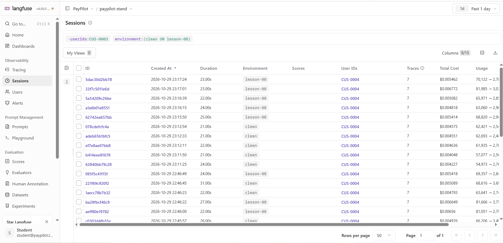
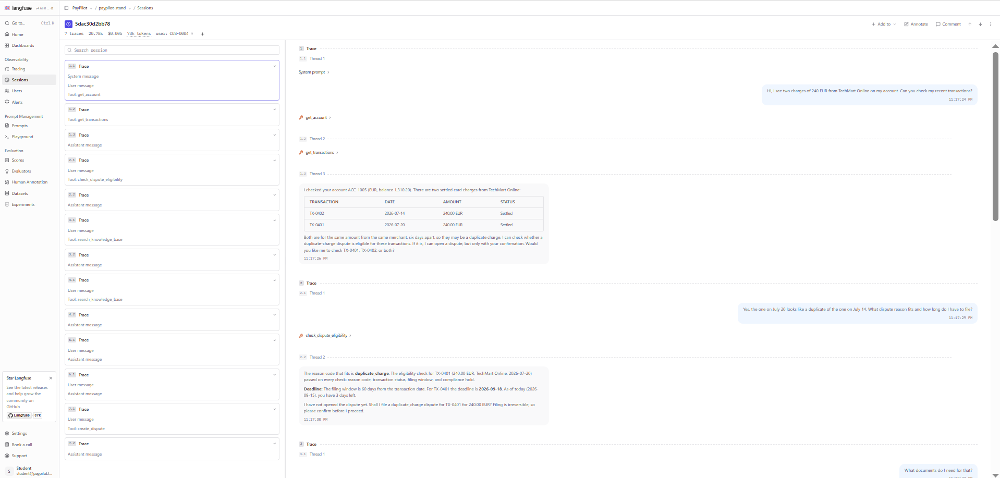

# Observability & Cost Report · PayPilot

| Field | Value |
|---|---|
| System | PayPilot, local training environment |
| Stand version | 74f1995ca8e8e64e4526e374535c2c4e71a2bde1 |
| Main model | anthropic/claude-haiku-5.5 via OpenRouter |
| Migration comparison | google/gemini-2.5-flash → anthropic/claude-haiku-5.5 |
| Pricing source | L08 kit prices.json; Haiku prices also configured in Langfuse |
| Haiku rates per million tokens | Input $0.10; cached input $0.01; cache creation $0.125; output and reasoning $0.50 |
| Trace backend | Langfuse, receiving OpenTelemetry traces |
| Measurement dates | 28–29 October 2026 |
| Runs per condition | B1: one initial run; B2: one detailed run plus five-run comparison; B3: one run; B4: five runs; L03 budget: five runs per batch |
| Measurement tools | L08 evaluation kit, L03 budget runner, stand API and Langfuse |

## Slide 1 · Trace vs. Counter

Session `5dac30d2bb78`: customer `CUS-0004`, profile `lesson-08`,
seven dialogue steps. Langfuse shows a total cost of $0.005462.

**Blind spots table:**

| Counter or view | What it misses | How to check the full cost |
|---|---|---|
| `usage.cost_usd` with D14 | It leaves out retry costs. In our manual test it showed $0.000675, while the trace and provider both showed $0.002140. | Sum all model calls in the trace and compare with `usage.provider_cost_usd`. |
| Langfuse without a matching model definition | It shows no calculated cost, even though the model calls cost money. | Add a model definition matching the exact model name and configure its prices. |
| Langfuse with only input/output prices | It leaves cache and reasoning tokens unpriced. For our selected generation, input/output alone cost $0.00006790; including cached tokens gives $0.00009304-about 27% more than the incomplete calculation omits from the full cost. | Price all five token categories and compare with the provider cost for the same generation. |
| History summarization | In B3, `/chat` usage and the kit’s `$ trace` total exclude the summarization call. Clean B3 showed $0.001843  in `$trace`, but $0.002389 from the provider. | Include `agent.summarize` in Langfuse and use `$ provider` for the full dialogue cost. |

**B3 incident analysis:** 

**Scenario:** B3, customer CUS-0004, profile `lesson-05`.
History is summarized after the second dialogue step.

| Step | Span | What it contains | What went wrong |
|---|---|---|---|
| 2 | `tool.check_dispute_eligibility` | The result confirms eligibility for `duplicate_charge`, a 60-day window and deadline `2026-09-18`. The conversation identifies `TX-0401`, EUR 240. | The required details are still available before summarization. |
| **3** | **`agent.summarize` - first confirmed loss** | **Input:** `TX-0401`, EUR 240 and `duplicate_charge`. **Output:** a general description of two charges and an eligible dispute, without the transaction ID, amount or exact reason code. | The summary loses the details needed to continue the case. |
| 4 | First `llm.call` | Its output requests `get_account` with empty arguments. | The agent starts retrieving account information again. |
| 4 | `tool.get_transactions` | Called with `account_id: ACC-1005` and `limit: 50`; returns the transaction records again. | Additional calls recover information that was already known before summarization. |

**Input versus output:** The input to `agent.summarize` contains
`TX-0401` and `duplicate_charge`. Its output omits both exact values,
although it retains the general idea of a duplicate-charge dispute.

**For the regulator:** At step 3, `agent.summarize` omitted the transaction
identifier and exact dispute reason code from the case summary, causing
the agent to retrieve account and transaction information again at step 4.

**Cost from three sources**:

The table below compares one seven-step C-07 run per condition from B2.
The B3 incident above uses `lesson-05`; this cost comparison uses
`clean` and `lesson-08`.

| Scenario | Condition | System report (`usage.cost_usd`) | Sum of model spans | Provider cost | Comparison |
|---|---|---:|---:|---:|---|
| B2 / C-07 | clean | $0.004544 | $0.004544 | $0.004544 | All three agree. |
| B2 / C-07 | lesson-08 | $0.005403 | $0.005403 | $0.005403 | All three agree. |

Here, the cost counter is accurate. The defect adds repeated tool results
to the prompt, so the model processes more input and the dialogue costs more.
These are individual runs, not five-run medians.

**Scenario cost**:

B2 results below are medians from five runs per condition.

| Measurement | clean | lesson-08 | Defect / baseline |
|---|---:|---:|---:|
| Input tokens, median | 57,544 | 69,132 | ×1.20 |
| Dialogue time, median | 22.987 s | 22.747 s | ×0.99 |
| Dialogue cost, median, from spans | $0.004267 | $0.005311 | ×1.24 |

The defective profile costs about 24% more, while median response time
is almost unchanged. 

## Slide 2 · Cost forecast

### Measured costs

Current model: `anthropic/claude-haiku-5.5`.

| Level | Measured cost | Evidence |
|---|---:|---|
| One step, clean | $0.000296 | Manual B1 request; trace and provider agree. |
| One step, D14 | $0.002140 | Same question with retries; trace and provider agree. |
| B1 dialogue, clean | $0.000378 | B4: median of five runs. |
| B2 dialogue, clean | $0.004109 | B4: median of five runs. |

B1 is a short account/transaction conversation.
B2 is the seven-step C-07 dispute conversation.

### Planning assumptions

| Assumption | Value | Source |
|---|---:|---|
| Monthly active users | 800 | Homework planning target |
| Dialogues per user per month | 10 | My planning assumption |
| Short conversations like B1 | 80% | My assumed scenario mix |
| Longer conversations like B2 | 20% | My assumed scenario mix |
| Cost per scenario | Clean B4 medians above | Lab measurements |

### Monthly estimate

Estimated dialogues: 800 × 10 = 8,000 per month.

Estimated cost per dialogue:
0.80 × $0.000378 + 0.20 × $0.004109 = $0.0011242.

Estimated monthly model cost:
8,000 × $0.0011242 = **$8.99**.

This estimate uses clean behaviour. It excludes hosting, monitoring and
human support. 

### Forecast for N users

Monthly model cost:
C(N) = N × 10 × (0.80 × $0.000378 + 0.20 × $0.004109)
     = N × $0.011242.

This formula assumes the same number, length and mix of dialogues per user.

**What can grow faster than N:** With fixed dialogue behaviour, cost grows
linearly with the number of users. However, longer conversations can cost
more than proportionally to their number of steps: each new call processes
the growing history again. D15 adds duplicated tool results to that input,
increasing the cost further.

D14 is a loud defect: repeated calls increase cost and waiting time.
D15 is quieter: input and cost grow even when tool-call counts and timing
look normal. Neither measurement proves that cost grows faster than the
number of users alone.

## Slide 3 · Decision

### Cost controls and tradeoffs

| Change | Expected benefit | What gets worse or needs protection |
|---|---|---|
| Remove repeated calls after an empty result (D14) | Fewer model calls, lower cost and shorter waiting time. | No intended loss for this defect fix. Use retries with limitations only in cases of truly temporary failures. |
| Remove duplicated history from the prompt (D15) | Less repeated input and lower dialogue cost. | No intended loss if the original history remains available. Verify that necessary context is preserved. |
| Switch from Gemini to Haiku | Clean B1 and B2 dialogues were about 26–27% cheaper. | Median dialogue time increased; answer quality still needs evaluation. |
| Summarize history earlier | Could reduce input in longer conversations. | Important details can disappear. In B3, lost details caused additional tool calls. The summarization call also costs money. |

**What we trade:** Haiku offers lower measured dialogue costs in exchange
for longer waiting times. Earlier summarization exchanges detailed history
for a shorter summary, with a risk of losing necessary information.

**What we will not do:** We will not approve migration as a substitute for
fixing D14 and D15. We will not summarize earlier while summaries lose
transaction IDs or reason codes.

**When the decision changes:** Migration can be approved after the defects
are fixed, regression checks pass, answer quality is acceptable and the
longer response times meet the product's requirements. Earlier summarization
requires both preserved case details and lower total provider cost.

### Model migration

Comparison: `google/gemini-2.5-flash` → `anthropic/claude-haiku-5.5`.
B4 ran each scenario and condition five times on each model.
Costs below are per dialogue.

| Model | Scenario | Condition | Cost: median (min–max), USD | Time: median | Check result |
|---|---|---|---:|---:|---|
| Gemini | B1 | clean | 0.000518 (0.000498–0.000653) | 3.2 s | 5/5 passed |
| Gemini | B1 | D14 | 0.001921 (0.001825–0.010974) | 9.1 s | 0/5 passed: repeated calls |
| Gemini | B2 | clean | 0.005537 (0.005086–0.006473) | 11.8 s | PASS: median step-6 input 3,086 ≤ 6,500 |
| Gemini | B2 | lesson-08 | 0.007757 (0.007436–0.007964) | 11.6 s | PASS: median step-6 input 3,751 ≤ 6,500 |
| Haiku | B1 | clean | 0.000378 (0.000325–0.000628) | 4.5 s | 5/5 passed |
| Haiku | B1 | D14 | 0.001832 (0.001788–0.001934) | 18.7 s | 0/5 passed: repeated calls |
| Haiku | B2 | clean | 0.004109 (0.003950–0.004625) | 21.6 s | PASS: median step-6 input 5,811 ≤ 6,500 |
| Haiku | B2 | lesson-08 | 0.006560 (0.005128–0.007058) | 23.7 s | FAIL: median step-6 input 7,269 > 6,500 |

**Decision: migrate only after the conditions below are met.**

- **What is cheaper:** On clean B1, Haiku is approximately 27% cheaper
  (Gemini costs 1.37× as much), but takes 4.5 s instead of 3.2 s.
  On clean B2, Haiku is approximately 26% cheaper
  (Gemini costs 1.35× as much), but takes 21.6 s instead of 11.8 s.
- **What stayed green:** B1 baseline passed 5/5 on both models.
  B2 baseline passed its median check on both models.
  The B1 repeat check detected D14 in all five runs on both models.
  The B2 token threshold detected the defect on Haiku but missed it on Gemini.
- **What the checks do not see:** These checks do not establish whether
  answers are accurate, complete, clear.
  A cheaper dialogue is not automatically an equally good dialogue.

**Thresholds to recalibrate:** Re-measure B2's step-6 input-token threshold
and C07-BUDGET's total-token and latency budgets for the target model.
If a monetary budget is added, calibrate it using full dialogue costs.

**Still unmeasured - answers for the L09 judge:**
- B1: Does the answer distinguish an empty transaction list from a service failure?
- C-07 step 2: Are the reason code, filing window and deadline explained correctly?
- C-07 steps 3-4: Are the document requirements and card-safety advice supported?
- C-07 steps 5-6: Does the agent recall the correct transaction, amount and deadline?
- C-07 step 7: Does the final answer accurately describe the tool result?
- Across both models: Is the response clear and complete without unsupported claims?

### Budgets recorded in cases

File: [sets/l05_dialogs.jsonl](../sets/l05_dialogs.jsonl).

| Case | Token limit | Time limit | Identical-call limit per step | Gate | Runs |
|---|---:|---:|---:|---|---:|
| CONV-H01 | 51,000 | 29,000 ms | - | release | 5 |
| CONV-H02 | 36,000 | 25,000 ms | - | release | 5 |
| CONV-H03 | 42,000 | 22,000 ms | - | release | 5 |
| CONV-H04 | 90,000 | 38,000 ms | - | release | 5 |
| CONV-H05 | 43,000 | 23,000 ms | - | release | 5 |
| C07-BUDGET | 72,000 | 35,000 ms | - | release | 5 |
| EMPTY-HISTORY-BUDGET |- | - | 1 | daily | 1 |

All six cases passed clean verification across the saved reports.

On lesson-08:
- EMPTY-HISTORY-BUDGET failed because 8 identical calls exceeded the limit of 1.
- CONV-H05 passed all memory checks but failed its token budget:
  median 60,997 > 43,000.

Token and time limits use clean measurements plus a documented margin.
H01 and H02 initially failed clean verification; their token limits were
recalibrated using ten clean runs, then passed a fresh five-run batch.
Earlier failed reports are retained.

Token and time checks compare medians, so they do not catch every outlier.
For example, H03 passed despite one run taking 86.5 seconds.

### Threshold calibration: CONV-H05

Model: anthropic/claude-haiku-5.5.
Each batch contains five runs.

- Initial clean calibration median: 38,373 tokens.
- Independent clean verification median: 40,398 tokens.
- lesson-08 median: 60,997 tokens.

The following table applies three thresholds to the same saved
verification results. These are offline comparisons, not additional runs.

| tokens_total threshold | clean: 40,398 | lesson-08: 60,997 | Verdict |
|---|---|---|---|
| 65,000 - too loose | PASS | PASS | Misses the defect. |
| 39,000 - too tight | FAIL | FAIL | Rejects normal clean behaviour as well. |
| 43,000 - selected | PASS | FAIL | Separates clean and defective behaviour in these batches. |

The tight limit of 39,000 would pass the initial clean median of 38,373,
but fail the independent clean median of 40,398. This demonstrates why
one clean batch is not enough to establish a reliable margin.

The selected limit was calculated before the defect run:
38,373 × 1.10 = 42,210.3, rounded up to 43,000.

Margin above the initial clean median:
(43,000 / 38,373 − 1) × 100 = 12.1%.

Margin above the independent clean median:
(43,000 / 40,398 − 1) × 100 = 6.4%.

The selected limit catches the lesson-08 increase while allowing the
observed clean variation. 

Evidence:
- Calibration: reports/l05_dialogs-clean-20261030T214343.json
- Clean verification: reports/l05_dialogs-clean-20261030T220628.json
- Defect: reports/l05_dialogs-lesson-08-20261030T220326.json

### Full-set verification

The complete set ran with `--gate all` on both profiles.

- clean: 7/7 cases passed.
- lesson-08: 2/7 passed; five cases failed their budgets.
- All configured memory checks passed on both profiles.
- EMPTY-HISTORY-BUDGET detected eight identical calls, exceeding one.
- H03, H04, H05 and C07-BUDGET exceeded their token limits.
- The final run used the clean profile.

Reports:
- reports/l05_dialogs-lesson-08-20261030T224612.json
- reports/l05_dialogs-clean-20261030T230017.json

## Predictions before the lab

1. With D14, I expect the actual step cost to be about 5 times
   the cost shown in usage.cost_usd, because retries are omitted.

2. I expect the provider's charge and the sum of model-span costs
   for the same step to approximately match.

3. I expect the seven-turn C-07 dialogue on lesson-08 to cost
   about 1.25 times as much as on clean, because tool results
   are added to the context twice.

4. I expect summarizing history after the second turn to make
   the whole dialogue cheaper. The summary itself costs money,
   but later calls should process less history.

### Comparison with measured results

1. **D14:** The actual cost was about 3.17 times the reported cost
   in the manual request, and about 5.41 times on the affected
   second step of B1. The prediction was close for B1.

2. **Cost sources:** Provider cost and model-span cost approximately
   matched for the tested steps without summarization.
   In B3, the kit's span total excluded the summarization call,
   so it was lower than the provider total.

3. **D15:** The five-run B2 comparison showed a cost increase
   of about 1.24 times, close to the predicted 1.25 times.

4. **Summarization:** The prediction remains unconfirmed.
   B3 showed that faulty summarization lost important details
   and caused additional tool calls. We did not measure a matching
   no-summarization control, so these results do not establish
   whether earlier summarization reduces total cost.